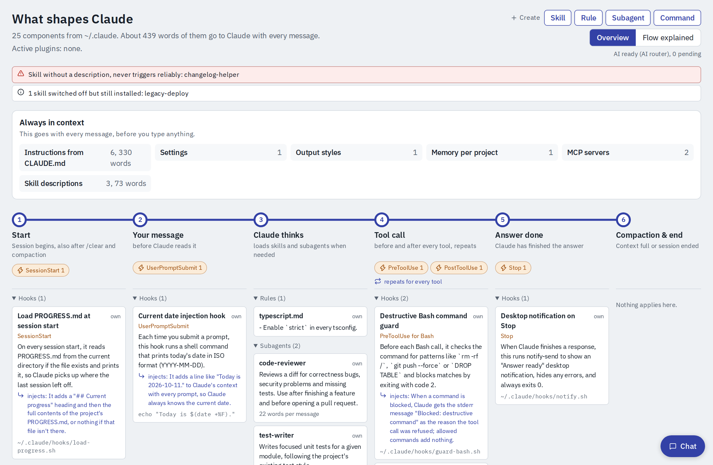
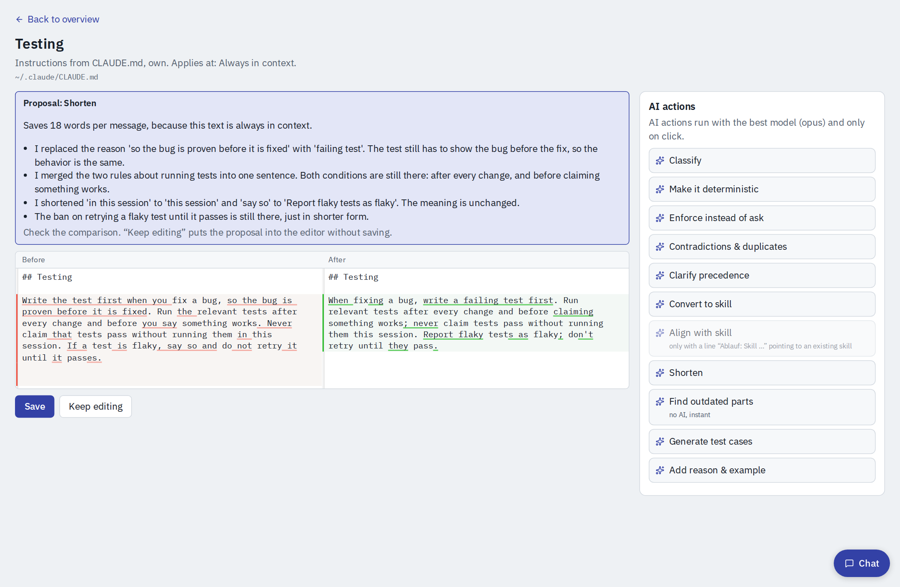
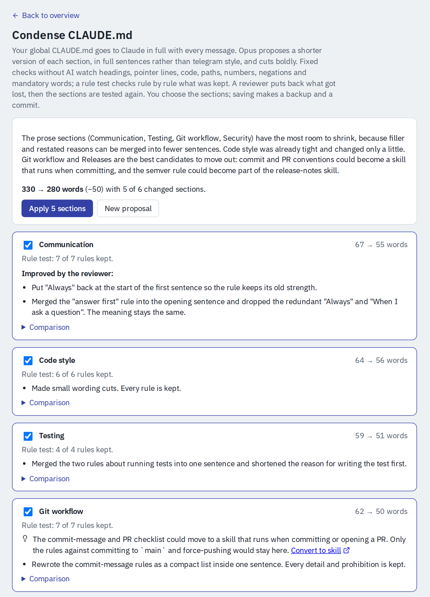
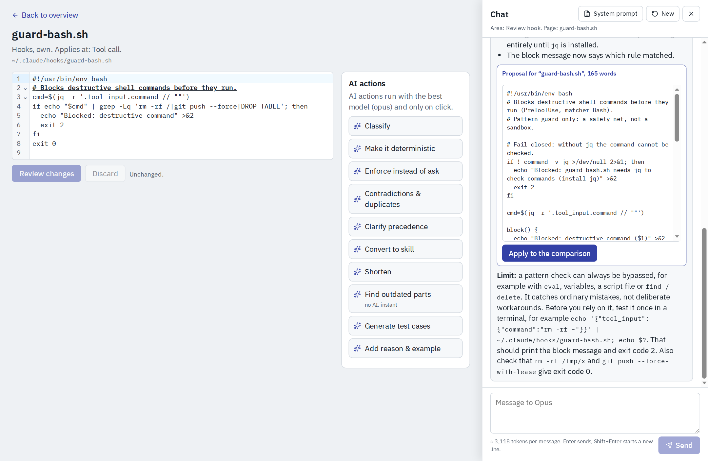
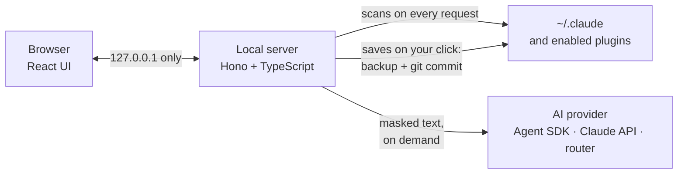

<div align="center">

# Context Atlas for Claude Code

**See everything that shapes Claude, and make it leaner, clearer and consistent.**

A local web app that maps your Claude Code setup (CLAUDE.md, rules, skills, hooks, subagents,<br>
MCP servers, plugins, memory) by *when* it acts in a session, and helps you improve it with Claude itself.

[](LICENSE)




</div>

## Why

Before you type a single word, Claude Code has already read a lot: your global CLAUDE.md, rules, every skill description, MCP servers, memory, an output style. Hooks run on their own at session start, on every message and around every tool call. Plugins add more of each.

None of this is visible in one place. Instructions grow, contradict each other or say the same thing twice, a skill without a description never triggers, a hook injects text nobody remembers. And every word that is always in context is paid for with every message.

Context Atlas puts all of it on one page, ordered by the moment it acts, and gives you tools to clean it up without losing a rule.

## Highlights

**One map of everything.** Every component of `~/.claude` and of your enabled plugins, placed on the six stations of a session: start, your message, Claude thinks, tool call, answer done, compaction and end. A band above shows what is always in context and how many words that adds to every message. Hints point out broken links between instructions and skills, skills without a description and switched-off leftovers.

**Plain-language explanations.** Claude explains every hook in one sentence, including what it injects into Claude's context. The *Flow explained* view shows the same as a sequence diagram of a session.

**AI quick actions, on click only.** Eleven actions for any instruction, rule, skill or agent: *Classify*, *Make it deterministic*, *Enforce instead of ask*, *Contradictions & duplicates*, *Clarify precedence*, *Convert to skill*, *Align with skill*, *Shorten*, *Find outdated parts*, *Generate test cases* and *Add reason & example*. Each one shows the model and the token estimate before it starts. Results come back as a proposal next to the current text. Nothing is saved until you say so.



**Condense your CLAUDE.md without losing rules.** Claude rewrites every section as short as possible, in plain prose, not telegram style. Fixed checks without AI guard headings, code, paths, numbers, negations and mandatory words. An independent rule test then compares old and new text rule by rule. A reviewer puts back whatever got lost or weaker, and the repaired sections are tested again. Only sections that are shorter and pass every check are preselected.



**A chat that knows the page you are on.** The chat sees the current page, reads other components in full when it needs them, and proposes changes as a diff you can apply. It also creates new skills, rules, subagents and slash commands. Before anything is written, it checks against what you already have and runs fixed checks on the new file (name, description, frontmatter).



**Safe by design.** The server listens on `127.0.0.1` only and refuses foreign hosts and cross-site requests. Secret-like values are masked before any text leaves your machine. Claude never writes a file itself; every save is your click. Each save makes a backup and a commit in a separate git history of `~/.claude`, stored outside of it.

**Your files, your language.** The interface is in English; your instructions, rules and skills can be written in any language. Proposed edits keep the language of the file, and the chat answers in the language you write in.

## Quick start

You need **Node.js 24** or newer, **git**, and Claude Code if you want to use your Claude subscription for the AI features.

```bash
git clone https://github.com/CyberGitJul/context-atlas.git
cd context-atlas
npm install
cp .env.example .env   # choose an AI provider (optional, see below)
./start.sh             # builds the UI, starts http://127.0.0.1:8795 and opens it
```

`start.sh` stops a running instance of the app first; the log is in `.run/server.log`. The map works without any AI provider; only explanations, quick actions, condensing and the chat need one.

## Choose an AI provider

Set `AI_PROVIDER` in `.env`:

| `AI_PROVIDER` | You need | Billing |
|---|---|---|
| `agent-sdk` | Claude Code installed and logged in on this machine | counts against your Claude plan's usage limits |
| `anthropic` | `ANTHROPIC_API_KEY` | per token via the Claude API |
| `router` | `ROUTER_URL` and `ROUTER_API_KEY` of your own OpenAI-compatible router | as your router bills |

The Agent SDK runs isolated: it loads none of your settings, hooks, CLAUDE.md, MCP servers or plugins, has no tools except the app's own read tool, and writes no session files.

## Configuration

All settings go into `.env` (see [`.env.example`](.env.example)) or the environment.

| Variable | Default | Purpose |
|---|---|---|
| `AI_PROVIDER` | off | `agent-sdk`, `anthropic` or `router` |
| `AI_MODEL` | `opus` | model for the background explanations: `opus`, `sonnet`, `haiku` or a full model ID |
| `AI_MODEL_EDIT` | `opus` | model for quick actions, condensing and the chat |
| `ANTHROPIC_API_KEY` | | for `AI_PROVIDER=anthropic` |
| `ROUTER_URL`, `ROUTER_API_KEY` | | for `AI_PROVIDER=router` |
| `PROJECT_ROOTS` | none | folders with your projects, separated like `PATH`, `~` allowed. Skills linked into `~/.claude/skills` from there become editable |
| `PORT` | `8795` | port of the local server |
| `CLAUDE_CONFIG_DIR` | `~/.claude` | the Claude Code folder to map, as Claude Code itself reads it |

## Make it yours

The app ships with generic prompts in [`config/prompts/`](config/prompts). Your own versions go into `~/.config/context-atlas/prompts/` (or `$XDG_CONFIG_HOME`) under the same file names and replace the generic ones. You can also edit them from the chat panel (*System prompt*).

- `_personal.md` is appended to every system prompt, for example your name, your language or your own rules.
- `chat-files.json` lists single files outside `~/.claude` that the chat may propose changes to, for example a project index.
- `live-sources.json` lists sources that only exist at runtime, such as claude.ai connectors, the IDE integration or Claude in Chrome, so the map shows them too.

## How it works



- **Read:** one scanner per source (instructions, rules, skills, hooks, MCP, plugins, agents, commands, output styles, settings, memory) reads fresh from disk on every request. Nothing is cached except the AI explanations.
- **Write:** only your own files under `~/.claude` (and skills inside `PROJECT_ROOTS`) are editable. Plugin files, claude.ai-synced skills and anything Claude Code manages itself stay read-only. Every save checks that the file did not change meanwhile, keeps a backup in `~/.cache/context-atlas/backups` and commits to `~/.local/share/context-atlas/claude-config.git`. That git history lives outside `~/.claude` and tracks only hand-written configuration.
- **AI:** structured answers (JSON schemas) for the quick actions; a streamed chat with one read tool. Explanations are cached per model.

## Privacy and security

- Configuration text goes to the AI provider you chose, and only when you trigger an AI feature or the background explanations of hooks run. Values that look like secrets are masked before sending. The masking is pattern-based, so treat it as a safety net, not a guarantee.
- Each chat turn is logged, masked, to `~/.local/state/context-atlas/chat-logs/`. Logs older than 5 days are deleted.
- Texts that contain secret-like values cannot be sent to the AI or edited in the app, so a save can never write a mask over a real secret.

Details, known limits and how to report a vulnerability: [SECURITY.md](SECURITY.md).

## Development

| Command | Purpose |
|---|---|
| `./start.sh` | build, start and open in the browser |
| `npm run dev` | server with auto-reload; run `npx vite` alongside for the UI (proxies `/api`) |
| `npm test` | tests (Vitest, with a fixture home in `tests/fixtures/home`) |
| `npm run typecheck` | TypeScript checks for server and web |

The stack is Node 24, TypeScript (ESM, run with `tsx`), Hono and React with Vite. The code is organized like this:

```
src/server/scan/      one scanner per configuration source
src/server/edit/      saving, backups, git history, checks for proposed files
src/server/ai/        AI providers, quick actions, condensing, chat and its read tool
src/server/messages/  server texts shown in the interface
src/shared/           data model and logic shared by server and UI
web/src/              the interface; texts in web/src/text.ts and web/src/locales/
config/prompts/       generic prompts; chat areas in config/prompts/chat/
```

The app has been used on Linux. macOS should work; Windows is untested (`start.sh` needs bash).

## License

[MIT](LICENSE). Third-party notices: the IBM Plex fonts are licensed under the SIL Open Font License 1.1. The Claude Agent SDK, used for `AI_PROVIDER=agent-sdk`, is subject to Anthropic's own terms.

Context Atlas is an independent project. It is not affiliated with, endorsed by or sponsored by Anthropic. Claude and Claude Code are trademarks of Anthropic, PBC.
